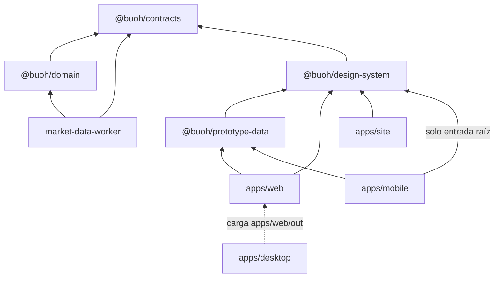

# Estado del código

Radiografía del repositorio el 2026-10-25 (commit `869ba4e`; la fila del sitio se actualizó el 2026-10-26, y las del worker y de `scripts/`, por última vez el 2026-10-31), para que otra persona o una IA entienda qué hay, cómo se conecta y dónde se repite lógica. Es un documento de análisis: no decide nada ni autoriza trabajo. El estado del proyecto lo manda [`PROJECT_STATUS.md`](../../PROJECT_STATUS.md), y lo que falta está en la [especificación de pendientes](../plan/especificacion-de-pendientes.md).

## 1. Qué hay

| Pieza | Qué hace | Depende de | Fuente que la gobierna |
|---|---|---|---|
| `packages/contracts` | Esquemas runtime (Zod), identidades canónicas (JCS y SHA-256) y validaciones entre artefactos de un dataset. De sus esquemas `…Structural` salen los JSON Schema de `generated/`. | — | [Contratos de dominio](contratos-de-dominio.md), ADR-0004 |
| `packages/domain` | Lógica pura de Fase 1: normalizar frames, reglas de calidad, publicación de datasets y derivación de la salud. Sin red, reloj ni almacenamiento. | contracts | Plan de Fase 1, ADR-0004 |
| `apps/market-data-worker` | Log raw-first, publicación y replay sobre PostgreSQL y S3-compatible, y el adaptador público de Deriv con su catálogo versionado (`src/deriv/`). CLI: `db:migrate`, `fixture:publish`, `replay`, `smoke`, `ingest`, `health` y `operations`. La sesión de ingesta reconecta con espera exponencial, repara los cierres no registrados y recupera la historia del hueco con `ticks_history` (ADR-0015); `smoke` la corre en memoria y, con `--interrupt-after-seconds`, corta su propio socket una vez para probar la reconexión. Con su almacén, comprueba el log contra el último cursor al arrancar, escribe el cursor y el latido (migración `0004`) y para sola al cumplirse la retención. Desde F2.1, en `ingest` escribe también el punto de control del estado vivo de cada segmento cerrado (migración `0005`, ADR-0017), y su arranque, su reparación de cierres y su vigilancia de huecos parten del último válido, sin leer el log entero (`src/source-log/live-reader.ts`). `ingest` la corre de forma continua sobre PostgreSQL y S3-compatible, con un esquema y un bucket propios, la retención de 23 horas y el esquema de fuente guardado (`src/ingest.ts`). `health` (`pnpm run data:health -- --json`) deriva el `HealthReport` de esa captura desde fuera del proceso que ingiere, sin tomar el bloqueo ni escribir nada (`src/health/`, ADR-0015 §8), y desde F2.1 también parte del último punto de control válido, sin leer el log entero. `ingest` y `health` arrancan con los tamaños de V8 de `src/node-flags.ts` (`WORKER_NODE_FLAGS`), para que su memoria no dependa de la máquina (ADR-0017 §9). Desde F2.2, la conexión a PostgreSQL se cifra según `BUOH_POSTGRES_SSLMODE`, obligatoria en `production` y `staging`; `src/postgres/roles.ts` crea los roles de producción y les da sus privilegios, y `db:migrate` migra como el rol dueño y escribe una línea JSON saneada (ADR-0018 §8 y §9). `src/successive-logs.ts` da el esquema y el prefijo de cada log de producción y busca el log activo, y en `production` `health` observa ese log (ADR-0018 §6). En `production`, `ingest` espera sin escribir nada el log activo, sus migraciones y el bloqueo (`src/ingest-startup.ts`) y captura en ese log sin la parada de las 23 horas (ADR-0018 §4). `operations` es el cron job `buoh-operaciones` (`src/operations/`, ADR-0018 §11): crea y ajusta los roles, migra cada log con `db:migrate` en un proceso aparte, que ya solo lee las variables de PostgreSQL, le da sus privilegios, prepara el siguiente y pone las contraseñas; después corre `health --log` sobre el log activo, en un proceso con solo `buoh_salud` y el token `salud`, y guarda su informe en la tabla `operations_reports` de ese log (migración `0006`). También vuelve a leer, con el token `operaciones`, los segmentos cerrados que le tocan a cada ejecución y compara sus hashes (`src/operations/verification.ts`), y una vez al día mide el espacio de la base y de cada log. | contracts, domain | Runbook de ingesta, ADR-0004, ADR-0005, ADR-0012 |
| `packages/design-system` | Tokens de marca, CSS generado, iconos, logotipo vectorizado y componentes React web. | contracts | [Guía de marca](../diseno/marca-buoh.md), ADR-0008, ADR-0011 |
| `packages/prototype-data` | Datos ficticios fijos compartidos por los prototipos, más formatos de fecha y `worstDrawdown`. | design-system | ADR-0009 §2 |
| `apps/web` | Prototipo navegable, exportación estática de Next.js. | design-system, prototype-data | [Concepto de interfaz](../diseno/concepto-de-interfaz.md), ADR-0008 |
| `apps/site` | Sitio oficial estático; `render.yaml` lo define para Render, sin indexar. | design-system | [Sitio oficial](../diseno/sitio-oficial.md), ADR-0008, ADR-0013 |
| `apps/mobile` | Prototipo Expo con cinco pestañas. | design-system (solo la entrada raíz), prototype-data | ADR-0009 |
| `apps/desktop` | Ventana Tauri 2 que muestra `apps/web/out`, con su instalador de Windows. | web (para compilar) | ADR-0010 |
| `scripts/` | Guardia documental (`check-doc-impact.mjs`), comprobación del runtime, envoltorios de `data:replay`, `data:smoke` y `data:health`, las pruebas de `render.yaml` y de `render-datos.yaml`, el Blueprint del sistema de datos (ADR-0018 §2), y los scripts de evidencia (`scripts/evidencia-*`), que no son comandos del producto. | — | CONTRIBUTING.md |

Entre las dos mitades no circulan datos: la ruta de datos (contracts, domain y worker) no tiene API, y los clientes visuales solo usan datos ficticios. Lo único que comparten son tipos: el sistema de diseño, `prototype-data`, `apps/web/app/guia/page.tsx` y `apps/mobile/src/ui.tsx` importan de `@buoh/contracts` solo con `import type` (por ejemplo `ExecutionMode` y `ServiceHealth`). `prototype-data`, la web, el móvil y el sitio también declaran `@buoh/contracts` en su `package.json`; la tabla y el diagrama omiten esas flechas para no cargarlos.

### Reglas que conviene conocer antes de cambiar código

- [AGENTS.md](../../AGENTS.md): autoridad por materia, invariantes, una sola revisión semántica por PR y desarrollo por fases.
- [CONTRIBUTING.md](../../CONTRIBUTING.md): ramas, commits `tipo(ámbito): resumen` y `pnpm run verify:pr` antes de abrir un PR.
- **Guardia documental** ([`docs/impact-map.json`](../impact-map.json)): tocar código de un área exige cambiar alguna de sus fuentes canónicas en el mismo PR, también si solo se añaden comentarios. En CI no se puede justificar una excepción.
- **Móvil:** ESLint prohíbe importar `@buoh/design-system/react` en `apps/mobile` (React 19.3.0 frente a 19.3.1; ADR-0009).
- **pnpm** corre los scripts con su emulador de shell (`shellEmulator`). Un script que deba separar stdout usa un archivo de `scripts/` (ADR-0003).
- `test-vectors/` es el oráculo. Solo cambia si el mismo PR justifica el contrato o la decisión en los contratos de dominio o en ADR-0004 (regla `test-vectors` de la guardia).

## 2. Código repetido

Cada hallazgo tiene un identificador (D-xx) para citarlo desde comentarios y PR. **Hechos:** las ubicaciones y lo que se repite, comprobados leyendo el código. **Propuestas:** lo que se podría hacer, sin aplicar. Ninguna se ha aplicado: refactorizar exige un PR propio con su revisión.

El PR que resuelva un D-xx quita del código los comentarios que lo citan y lo marca aquí como resuelto, con el número del PR. Los identificadores no se reutilizan.

### 2.1 Duplicación real

Misma lógica o el mismo conocimiento en varios lugares, que debería cambiar a la vez.

**D-01. Reglas de las insignias de estado, web y móvil**
- Dónde: `packages/design-system/src/react/Badges.tsx` (`ModeBadge`, `HealthBadge`, `SeverityTag`) y `apps/mobile/src/ui.tsx` (las mismas, en React Native).
- Qué se repite:
  - los nombres de eje «Modo», «Salud» y «Severidad»;
  - qué estados llevan borde fuerte (`real` y `critical`);
  - la plantilla del texto accesible, `Eje: etiqueta. descripción`.

  Etiquetas, tonos e iconos ya se comparten desde `status.ts`.
- Riesgo: cambiar una regla en una plataforma y olvidar la otra.
- Propuesta: llevar esas reglas, sin React, a `packages/design-system/src/status.ts`, por ejemplo `STATUS_AXIS`, `isStrongMode`, `isStrongSeverity` y `statusAccessibleText`. El móvil puede importarlas, porque son de la entrada raíz.

**D-02. Textos de evidencia, candado de fase y aviso de datos ficticios**
- Dónde: `packages/design-system/src/react/Blocks.tsx` y `apps/mobile/src/ui.tsx` (`EvidenceSourceBadge`, `PhaseLock`, `FictitiousDataNotice` y las filas de `MetricWithContext`).
- Qué se repite: «Disponible en Fase N», «Datos ficticios» y las etiquetas y el orden de Período, Muestra, Costes, Pérdidas, Drawdown máximo y Versión.
- **Ya difieren:** la insignia de origen backtest muestra «Backtest» en las dos plataformas, pero:
  - en la web, el texto accesible es «Origen: Backtest» y la ventana de ayuda (`title`) dice «Origen: backtest sobre datos pasados»;
  - en el móvil, el texto accesible (`accessibleLabel`) es «Origen: backtest» y no hay ventana de ayuda.
- Riesgo: añadir un campo obligatorio al contexto de una cifra (guía §3) obliga a tocar dos componentes y dos pruebas.
- Propuesta: constantes sin React en `packages/design-system/src/evidence.ts`, por ejemplo `PERFORMANCE_CONTEXT_ROWS`, `phaseLockText` y `FICTITIOUS_DATA_LABEL`.

**D-03. Ayudantes de las pruebas de exportación, web y sitio**
- Dónde: `apps/web/test/export.test.ts` y `apps/site/test/export.test.ts`.
- Qué se repite:
  - iguales: `files()`, `mainOf()` y `pageOf()`, y las pruebas de orden de títulos, recursos externos en HTML y CSS, logotipo y favicon;
  - con variantes: `textOf()`, que solo decodifica entidades HTML en el sitio, y otra versión en `apps/mobile/test/screens.test.tsx`.
- Riesgo: una corrección en una copia no llega a la otra. Por ejemplo, una frase prohibida con apóstrofo no se detectaría en la web.
- Propuesta: un módulo de apoyo para pruebas compartido. Crear un paquete nuevo es una decisión de estructura (AGENTS.md, desarrollo por fases).

**D-04. Lista de frases prohibidas**
- Dónde: `apps/web/test/export.test.ts`, `apps/mobile/test/screens.test.tsx` y `apps/site/test/export.test.ts`; la fuente es la guía de marca §3.
- Qué se repite: las mismas seis expresiones. El sitio añade «regístrate», «suscríbete» y «compra ahora», que no figuran en la guía §3. El sitio oficial §3 prohíbe registro y compras, pero no da frases.
- Riesgo: una frase nueva en la guía no se comprueba en ninguna parte hasta tocar tres archivos.
- Propuesta: exportar la lista desde la entrada raíz del sistema de diseño y comprobar, en una prueba, que cada frase está en la guía §3.

**D-05. Recorrido recursivo de archivos en pruebas**
- Dónde: `files()` en las pruebas de web y sitio, y `filesUnder()` en `apps/desktop/test/desktop.test.ts`.
- Riesgo: bajo.
- Propuesta: el mismo módulo de D-03, o `readdirSync(dir, { recursive: true })`.

**D-06. Orden canónico de ticks e incidencias**
- Dónde:
  - quien lo produce: `packages/domain/src/quality.ts` (`compareStrings`, `compareTicks` y `compareIncidents`);
  - quien lo valida: `packages/contracts/src/dataset-consistency.ts` (`compareCodeUnits`, `compareTicks` y `compareIncidents`);
  - el mismo comparador, una tercera vez: `compareJcsKeys` en `packages/domain/src/serialization.ts`.
- Aparte: `compareUtc` (`packages/contracts/src/scalars.ts`) usa `localeCompare`, que solo equivale porque los instantes tienen formato fijo. El orden de las condiciones tiene el mismo problema (D-13).
- Riesgo: si cambia el orden en un lado, la validación rechaza datasets bien construidos o acepta mal ordenados.
- Propuesta: exportar los comparadores desde `@buoh/contracts` y usarlos en `domain`, que ya depende de él.

**D-07. Formato `sha256:<hex>` de identificadores**
- Dónde:
  - `/^sha256:[0-9a-f]{64}$/u` en `scalars.ts` (dos veces), `conditions.ts` (`condition_event_id`) y `data-quality.ts` (`incident_id`);
  - `/^[0-9a-f]{64}$/u` otra vez en `apps/market-data-worker/src/object-keys.ts`.
- Propuesta: reutilizar `derivedEventIdSchema` y `sha256HexSchema`, y comprobar con `pnpm run schemas:check` que los JSON Schema no cambian.

**D-08. Escribir y volver a leer para verificar un objeto**
- Dónde: `writeVerified` en `apps/market-data-worker/src/publication.ts`, y la misma secuencia en `apps/market-data-worker/src/source-log/source-event-log.ts`.
- La secuencia es `putIfAbsent`, leer y comparar tamaño y SHA-256.
- Diferencia: una lanza `PublicationError`; la otra, un `Error` con `code: 'object_verification_failed'`.
- Propuesta: una sola función dentro del worker, con el tipo de error como parámetro.

**D-09. Lectura estricta de NDJSON y decisión del hash lógico**
- Dónde: `apps/market-data-worker/src/replay.ts` y `packages/contracts/src/vector-integrity.ts`, más una variante por línea en `source-event-log.ts`.
- Qué se repite: newline final, `JSON.parse` y comparación con su JCS.
- Qué difiere: cómo se decide si un objeto es un documento JSON cuyo hash lógico es su JCS:
  - replay lo decide por rol (`JSON_ROLES`);
  - el verificador de vectores, por `media_type`.
- Riesgo: un rol o tipo nuevo se clasificaría distinto en cada lado.
- Propuesta: funciones puras en `@buoh/contracts`, por ejemplo `parseCanonicalNdjson` e `isJsonDocumentArtifact`.

**D-10. Bytes del manifiesto**
- Dónde: `canonicalManifestBytes` (`packages/contracts/src/dataset.ts`) y `canonicalJsonBytes` (`packages/domain/src/serialization.ts`). Deben producir los mismos bytes.
- Propuesta: que `domain` use la de `contracts` para los manifiestos.

**D-11. Esqueleto de las dos apps Next.js**
- Dónde: `apps/web/app/layout.tsx` y `apps/site/app/layout.tsx`, y `apps/web/app/globals.css` (`.w-skip`) y `apps/site/app/site.css` (`.s-skip`).
- Qué se repite:
  - en los `layout.tsx`: las mismas importaciones de fuentes, y `themeColor: '#080F1B'` escrito a mano (es `noche.900`);
  - en las hojas de estilo: el enlace para saltar al contenido, igual en las dos.
- Propuesta: tomar `themeColor` del token y llevar el enlace de salto a `buoh.css`. Que sean dos apps es intencional (ADR-0008 §3).

**D-12. Ayudantes de las pruebas que prohíben efectos externos**
- Dónde:
  - `readVector` y `forbidAmbientEffects` en `apps/market-data-worker/test/publication-replay.test.ts` y `apps/market-data-worker/test/raw-first-log.test.ts`. Los cuerpos son idénticos (comparados texto a texto);
  - las dos, otra vez, en `packages/domain/test/pipeline-vectors.test.ts`. `readVector` es idéntica; `forbidAmbientEffects` solo cambia los mensajes de error («… en el pipeline»);
  - `rejection` en dos pruebas de `apps/market-data-worker/integration/`, sin comparar sus cuerpos.
- Riesgo: si se añade un efecto prohibido, por ejemplo otra fuente de azar, hay que acordarse de las tres copias.
- Propuesta: dentro del worker, moverlos a `test/support/`, que ya existe. Compartirlos con `domain` exigiría un módulo común (ver D-03).

**D-13. Orden de las condiciones**
- Dónde: las condiciones se ordenan por `occurred_at_utc` y luego por `condition_event_id` (contratos de dominio, «OperationalConditionEvent») en tres sitios:
  - `compareConditions` en `packages/domain/src/quality.ts`, que compara por unidades UTF-16 (`compareStrings`);
  - `validateConditionCausality` y `reduceOpenConditions` en `packages/contracts/src/conditions.ts`, que usan `localeCompare`.
- Riesgo: los dos métodos dan el mismo orden solo porque los instantes y los identificadores tienen formato fijo. Si cambia ese formato, `domain` podría escribir las condiciones en un orden que `contracts` lee de otra forma.
- Propuesta: un único comparador exportado desde `@buoh/contracts`, por unidades UTF-16, usado en los tres sitios.

**D-14. Esquema del perfil de calidad**
- Dónde: `qualityProfileSchema` en `packages/domain/src/profile.ts` y su copia en `packages/contracts/src/vector-integrity.ts`.
- Ya está registrado: es el pendiente 4 de F1.2 en `PROJECT_STATUS.md`.

### 2.2 Similitud intencional

| Caso | Por qué no se unifica |
|---|---|
| Componentes React Native del móvil y React del sistema de diseño (iconos, insignias, tarjetas) | ADR-0009 descarta componentes React Native en `packages/design-system`, y la regla de ESLint del móvil impide importar los de la web. Lo que sí se puede compartir es el conocimiento sin React (D-01 y D-02). |
| `next.config.ts`, `tsconfig` y `not-found.tsx` de web y sitio | Son aplicaciones separadas (ADR-0008 §3), con identificadores de build distintos que comprueban sus pruebas. |
| Valores esperados escritos en las pruebas (etiquetas de pestañas, filas del contexto) | Hacen de oráculo: importarlos del código haría que la prueba se comprobara a sí misma (AGENTS.md: pruebas derivadas de los criterios). |
| Pruebas que leen documentos (roadmap, catálogo, concepto) | Cada una comprueba una regla distinta contra su fuente. Solo el ayudante de lectura se repite. |
| Anchos de pantalla 1200, 960 y 640 px escritos a mano en `apps/web/app/globals.css` y `apps/site/app/site.css` (el sitio usa 960 y 640) | Coinciden con `breakpoints` de `packages/design-system/src/tokens.ts`, pero una variable CSS no puede usarse dentro de `@media`. Si cambian los tokens, hay que cambiar también las dos hojas a mano. |

### 2.3 Parecido, pero no repetido

- **Contraste:** todas las pruebas usan `contrastRatio` de `packages/design-system/src/contrast.ts`. La función de tono (`hue`) está una sola vez, en una prueba.
- **Formatos de fecha:** `formatUtc` y `formatUtcTime` solo existen en `prototype-data`. `epochSecondsToUtc` del normalizador hace otra cosa: produce instantes para los contratos.
- **Hash y JCS:** `canonicalJson` y `sha256Hex` existen una vez (`packages/contracts/src/identity.ts`).
- **Configuración y errores del worker:** la configuración se lee en un solo sitio, y las clases de error solo comparten el patrón de nombre.
- **Filtros de los datos ficticios:** `status === 'abierta'` y `lifecycle === 'paused'` aparecen en `apps/web/app/page.tsx` y en `apps/mobile/src/model.ts`, y también en una prueba. Son una línea cada uno; no se cuentan como duplicación.
- **Rust:** hay tres archivos, `main.rs`, `build.rs` y `navigation.rs`, y no repiten lógica. La lógica propia está en `navigation.rs`.

### 2.4 Exportaciones sin uso fuera de su paquete

Candidatas, no código muerto confirmado: no se revisó el uso dentro de cada paquete.

- **design-system:** `breakpoints`, `dayTheme`, `spaceVar`, `themeVariables` y `relativeLuminance`. Esta última solo la usa `contrastRatio`.
- **prototype-data:** `R100_SERIES_START_UTC` y varios tipos (`AuditRow`, `DatasetRow`, `Instrument`…).
- **domain:** `toPlainJson`, `getMember`, `JsonLexemeError`, `CONDITION_HEALTH`, `DERIVABLE_INCIDENT_SEVERITY`, `MEDIA_TYPES`, `NORMALIZER_VERSION`, `RESOLUTION_REASONS`, `SOURCE_LIMITS` y varios tipos.
- **contracts:** `canonicalManifestBytes` y `compareUtc`, que solo se usan dentro del paquete.

## 3. Comentarios en el código

El código ya explica sus flujos principales: replay, log raw-first, registro operativo, normalizador y reglas de calidad. Este análisis añadió comentarios donde faltaba el porqué:

- en contratos: patrón `…Structural` y refinado, identidades y orden canónico;
- en los gráficos y los datos ficticios: unidades, márgenes y accesibilidad;
- en la guardia documental;
- en las páginas de la web, y en las copias web y móvil de los componentes.

Los comentarios citan los D-xx de este documento.

No se comentó el worker. Su guardia documental pide cambiar el runbook o ADR-0004 en el mismo PR, y ninguno de los dos necesitaba cambios. Quedan con pocos comentarios:

- los almacenes de PostgreSQL (`src/postgres/*`);
- `src/s3/object-store.ts`;
- el punto de entrada `src/index.ts`.
