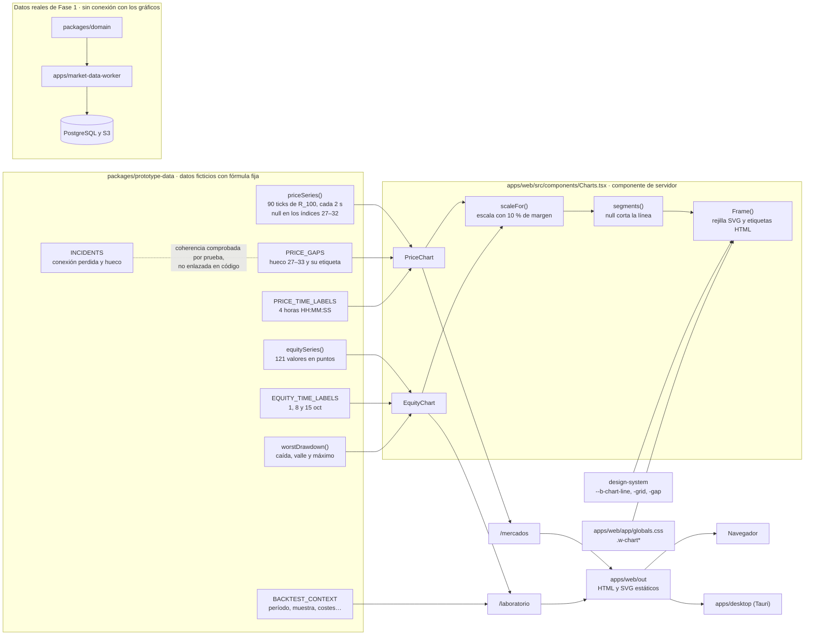

# Flujo actual de los gráficos

Cómo funcionan hoy los gráficos de buoh, desde los datos hasta la pantalla. Se reconstruyó leyendo el código el 2026-10-25 (commit `869ba4e`). Describe lo que existe, no el destino: las reglas de diseño están en la [guía de marca](marca-buoh.md) §8 y en el [concepto de interfaz](concepto-de-interfaz.md) §4 y §6. Lo que falta está en la [especificación de pendientes](../plan/especificacion-de-pendientes.md).

## 1. Resumen

- Hay **dos gráficos**, los dos en el prototipo web (`apps/web`): el de precios de R_100 en `/mercados` y la curva de resultados en `/laboratorio`.
- Los dos se alimentan **solo de datos ficticios** de `packages/prototype-data`, calculados con fórmulas fijas. El código no usa azar, reloj real ni red.
- Son **SVG propios** dibujados en el servidor durante la exportación estática de Next.js. No llevan JavaScript de cliente ni interacción.
- La app de escritorio muestra los mismos dos gráficos porque carga la exportación de la web. El móvil y el sitio no tienen gráficos.
- Los datos reales de Fase 1 (`market-data-worker` y `packages/domain`) **no están conectados** a ningún gráfico: no existe API ni dependencia entre ellos.

## 2. Diagrama

## 3. Datos de entrada

Todo sale de `packages/prototype-data/src`. El instante de referencia es `DEMO_NOW_UTC` (20 oct 2026, 14:32:05 UTC).

### Precios de R_100

| Pieza | Qué es |
|---|---|
| `R100_SERIES_START_UTC`, `R100_TICK_SECONDS` | La serie empieza a las 14:29:06 UTC y avanza un tick cada 2 s; son 90 ticks, hasta las 14:32:04. |
| `r100TickTimeUtc(index)` | Hora UTC de un tick. |
| `priceSeries()` | 90 valores con la fórmula `1040 + 3,1·sin(i/5,5) + 1,4·sin(i/1,65) + 0,024·i`, redondeados a 2 decimales. Los índices del hueco valen `null`. |
| `PRICE_GAPS` | Un hueco: índices 27 a 32 (14:30:00 a 14:30:10), con la etiqueta «Hueco: 6 ticks (12 s) · conexión perdida». `end` (33) es el primer tick después del hueco. |
| `PRICE_TIME_LABELS` | Etiquetas de tiempo en los índices 0, 30, 60 y 89, con la hora recortada del texto ISO. |

El hueco cuenta la misma historia que `INCIDENTS`: la conexión se perdió a las 14:29:59 y el hueco quedó sin resolver a las 14:30:12, la hora del índice 33. Esa coherencia la comprueba una prueba (`fixtures.test.ts`); el código no une la incidencia con el gráfico, y la etiqueta del hueco se escribe a mano.

### Curva de resultados

| Pieza | Qué es |
|---|---|
| `equitySeries()` | 121 valores con la fórmula `sin(i/9) − 0,011·i + 0,5·sin(i/2,7)`, redondeados a 2 decimales. Son puntos porcentuales de resultado acumulado hipotético. Termina en −0,4. |
| `EQUITY_TIME_LABELS` | «1 oct», «8 oct» y «15 oct» en los índices 0, 60 y 120. |
| `worstDrawdown(values)` | Mayor caída desde un máximo previo, en las unidades de la serie: 3,6 puntos, con el valle en el índice 98. Devuelve también el valor del máximo, no su índice. |
| `BACKTEST_CONTEXT` | El contexto que la página muestra al lado de la curva: período, muestra, costes, pérdidas, *drawdown*, versión y limitaciones. |

**Sin confirmar en el código:** qué tiempo representa cada uno de los 121 puntos. Las fechas solo se reparten a lo largo de la curva.

## 4. Procesamiento

Todo está en `apps/web/src/components/Charts.tsx`:

1. **Escala** (`scaleFor`). Busca el mínimo y el máximo sin contar los `null`, añade un 10 % de margen arriba y abajo, y en la curva de resultados incluye siempre el cero. El dibujo interno mide 1000 × 100.
2. **Trazo** (`segments`). Recorre los valores y levanta el lápiz en cada `null`: un hueco nunca se une ni se suaviza.
3. **Marco** (`Frame`). Dibuja 5 líneas de rejilla repartidas por igual en el rango con margen, que no son valores redondos. Coloca encima, en HTML, las cifras del eje vertical y las etiquetas de tiempo.
4. **Formato de cifras.**
   - Precios: `toFixed(2)`, con punto decimal.
   - Resultados: coma decimal y signo menos tipográfico (−).

## 5. Visualización

| | `PriceChart` en `/mercados` | `EquityChart` en `/laboratorio` |
|---|---|---|
| Alto | 240 px | 220 px |
| Línea | `--b-chart-line`, 1,75 px | `--b-chart-line`, 1,75 px |
| Marca propia | Banda discontinua en `--b-chart-gap` que va del último tick antes del hueco al primero después, con la nota del hueco encima | Línea de cero punteada y un segmento rojo vertical en el valle de la peor caída, con la nota «Peor caída: −3,6 pts» |
| Al lado | Lista de metadatos (`DataMeta`): símbolo, fuente, zona horaria UTC, intervalo, frescura y calidad | Tarjeta «Evidencia» con `MetricWithContext` y `BACKTEST_CONTEXT` |

Detalles comunes:

- El SVG usa `preserveAspectRatio="none"` y se estira al ancho de la tarjeta. Los trazos no se engordan al estirarse (`vector-effect: non-scaling-stroke`), y los textos son HTML, así que miden lo mismo en cualquier pantalla.
- Por debajo de 640 px se ocultan las etiquetas de tiempo intermedias.
- **Colores** (`packages/design-system/src/tokens.ts`, `chart`):

  | | Tema noche | Tema día |
  |---|---|---|
  | Línea | `boreal.300` | `boreal.700` |
  | Rejilla | `noche.700` | `papel.200` |
  | Hueco | `naranja.400` | `naranja.700` |

- **Accesibilidad.** Cada gráfico es una imagen (`role="img"`) cuyo nombre es el `label` que escribe la página. El lector de pantalla lee solo ese texto, no las etiquetas HTML de dentro. No hay tabla de datos alternativa.
- **Movimiento:** ninguno. La regla global de movimiento reducido existe, pero no tiene nada que desactivar aquí.

## 6. Interacción

No hay. Los gráficos no responden a pasar el ratón ni a tocar, y no tienen ventanas de ayuda, zoom ni selección de rango. Los únicos componentes de cliente de la web son el menú (`MoreMenu`) y los enlaces de navegación (`NavLink`).

## 7. Otros clientes

- **Escritorio** (`apps/desktop`): muestra `apps/web/out`, así que tiene los mismos dos gráficos, iguales a los de la web.
- **Móvil** (`apps/mobile`): no tiene gráficos. La pestaña Evidencia muestra cifras con su contexto. ADR-0009 §3 menciona `react-native-svg` «para gráficos», pero hoy solo dibuja iconos y el logo.
- **Sitio** (`apps/site`): no tiene gráficos ni cifras de desempeño, por regla (sitio oficial §3).

## 8. Pruebas que cubren los gráficos

| Prueba | Qué comprueba |
|---|---|
| `packages/prototype-data/test/fixtures.test.ts` | El hueco coincide con las incidencias y la conexión perdida; la curva termina en −0,4 y cae 3,6, igual que `BACKTEST_CONTEXT`; `priceSeries()` sale igual al llamarla dos veces. Nada vuelve a llamar a `equitySeries()` para compararla. |
| `apps/web/test/export.test.ts` | Nada propio de los gráficos. Sí comprueba que `/laboratorio` muestra el contexto completo de cada cifra. |
| `packages/design-system/test/tokens.test.ts` | Que los colores de los gráficos salen de la paleta. No mide su contraste. |

No hay pruebas de `scaleFor`, `segments` ni del SVG exportado.

## 9. Reglas documentadas frente al código

| Regla | Fuente | Estado |
|---|---|---|
| Líneas finas, sin degradados intensos ni 3D | guía §8 | Se cumple. |
| Los huecos se marcan y no se suavizan | guía §8, concepto §4 | Se cumple para huecos. Las demás incidencias no se dibujan; la conexión perdida aparece solo en la etiqueta del hueco. |
| Toda curva de resultados lleva modo, período, muestra y costes en la tarjeta de al lado | guía §8 | Se cumple. La tarjeta «Evidencia», junto a la curva, muestra el modo de la cifra (origen backtest), el período, la muestra y los costes de `BACKTEST_CONTEXT`. Del gráfico solo sale el período, en las fechas del eje y en su descripción accesible. Antes la guía los pedía dentro del gráfico; el propietario aceptó el 2026-10-25 que vayan al lado (P-V1-03, resuelto). |
| La curva de resultados marca el cero y la peor caída | concepto §6 | Se cumple. La peor caída es un segmento vertical en el valle, sin marcar el máximo. |
| Textos en HTML, con eje de tiempo | concepto §6 | Se cumple con etiquetas en índices fijos. No hay línea de eje ni rejilla vertical. |
| SVG propios, sin bibliotecas de gráficos | concepto §6, ADR-0008 §4 | Se cumple: `apps/web` no depende de ninguna. |
| Sin azar ni reloj real | ADR-0008 §2 | Se cumple por construcción: las series son fórmulas fijas del índice. Ninguna prueba prohíbe `Math.random` o `Date.now` en `apps/web` ni en `prototype-data`; solo se comprueba que `priceSeries()` se repite. |
| Contraste comprobado por pruebas | guía §10 | En parte: las etiquetas usan colores con contraste probado, pero la línea y la rejilla no se miden. |
| Gráficos de ticks y velas, en web, móvil (resumen) y escritorio | catálogo de funciones, Fase 2 | Es el destino, no lo actual. Hoy solo hay una línea de ticks ficticios, y nada en el móvil. |

## 10. Detalles a tener en cuenta

Son hechos del código actual, no fallos confirmados. Las propuestas están en la especificación de pendientes.

- **Unidades de la peor caída.** El gráfico dice «3,6 pts» y `BACKTEST_CONTEXT` dice «−3,6 %». `worstDrawdown` mide en las unidades de la serie, que son puntos.
- **Ancho de la banda del hueco.** Faltan 6 ticks (12 s), pero la banda va de un tick vecino al otro y abarca 14 s. Así se ven los dos bordes del corte.
- **Formato distinto en cada gráfico:** punto decimal en precios y coma en resultados.
- **Casos límite sin proteger:** una serie vacía o toda `null` daría coordenadas inválidas, y un hueco que empiece en el índice 0 saldría del dibujo. Hoy los datos fijos no los producen.
- **Descripción accesible escrita a mano.** El `label` de cada gráfico no se calcula de los datos; si cambian los datos, hay que cambiar el texto.
- **Dependencia del paquete de prototipo.** `Charts.tsx` importa `worstDrawdown` de `@buoh/prototype-data`; ADR-0009 §2 acepta este acoplamiento hasta que la Fase 2 traiga datos reales.
