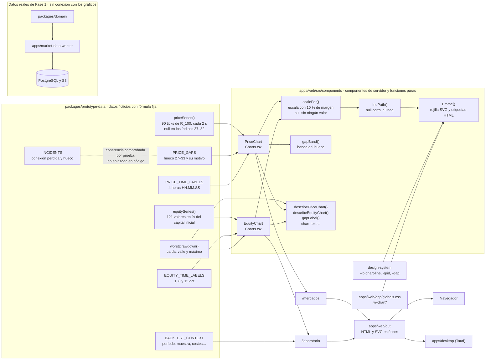

# Flujo actual de los gráficos

Cómo funcionan hoy los gráficos de buoh, desde los datos hasta la pantalla. Se reconstruyó leyendo el código el 2026-10-25 (commit `869ba4e`) y se actualizó el 2026-11-04 con `F2-CHART-001`. Describe lo que existe, no el destino: las reglas de diseño están en la [guía de marca](marca-buoh.md) §8 y §10 y en el [concepto de interfaz](concepto-de-interfaz.md) §4, §6 y §9. Lo que falta está en la [especificación de pendientes](../plan/especificacion-de-pendientes.md).

## 1. Resumen

- Hay **dos gráficos**, los dos en el prototipo web (`apps/web`): el de precios de R_100 en `/mercados` y la curva de resultados en `/laboratorio`.
- Los dos se alimentan **solo de datos ficticios** de `packages/prototype-data`, calculados con fórmulas fijas. El código no usa azar, reloj real ni red.
- Son **SVG propios** dibujados en el servidor durante la exportación estática de Next.js. No llevan JavaScript de cliente ni interacción.
- La app de escritorio muestra los mismos dos gráficos porque carga la exportación de la web. El móvil y el sitio no tienen gráficos.
- Los datos reales de Fase 1 (`market-data-worker` y `packages/domain`) **no están conectados** a ningún gráfico: no existe API ni dependencia entre ellos.

## 2. Diagrama

## 3. Datos de entrada

Todo sale de `packages/prototype-data/src`. El instante de referencia es `DEMO_NOW_UTC` (20 oct 2026, 14:32:05 UTC).

### Precios de R_100

| Pieza | Qué es |
|---|---|
| `R100_SERIES_START_UTC`, `R100_TICK_SECONDS` | La serie empieza a las 14:29:06 UTC y avanza un tick cada 2 s; son 90 ticks, hasta las 14:32:04. |
| `r100TickTimeUtc(index)` | Hora UTC de un tick. |
| `priceSeries()` | 90 valores con la fórmula `1040 + 3,1·sin(i/5,5) + 1,4·sin(i/1,65) + 0,024·i`, redondeados a 2 decimales. Los índices del hueco valen `null`. |
| `PRICE_GAPS` | Un hueco: índices 27 a 32 (14:30:00 a 14:30:10), con su motivo, «conexión perdida». `end` (33) es el primer tick después del hueco. |
| `PRICE_TIME_LABELS` | Etiquetas de tiempo en los índices 0, 30, 60 y 89, con la hora recortada del texto ISO. |

El hueco cuenta la misma historia que `INCIDENTS`: la conexión se perdió a las 14:29:59 y el hueco quedó sin resolver a las 14:30:12, la hora del índice 33. Esa coherencia, también la de su motivo, la comprueba una prueba (`fixtures.test.ts`); el código no une la incidencia con el gráfico. La nota del hueco, «Hueco: 6 ticks (12 s) · conexión perdida», y la alternativa en texto del gráfico se calculan de sus índices, de las horas de los ticks y de su motivo.

### Curva de resultados

| Pieza | Qué es |
|---|---|
| `equitySeries()` | 121 valores con la fórmula `sin(i/9) − 0,011·i + 0,5·sin(i/2,7)`, redondeados a 2 decimales. Son el resultado acumulado hipotético en % del capital inicial. Termina en −0,4. |
| `EQUITY_TIME_LABELS` | «1 oct», «8 oct» y «15 oct» en los índices 0, 60 y 120. |
| `worstDrawdown(values)` | Mayor caída desde un máximo previo, en las unidades de la serie: 3,6, con el valle en el índice 98 (−2,57) y el máximo en 1,03. Devuelve también el valor del máximo, no su índice. |
| `BACKTEST_CONTEXT` | El contexto que la página muestra al lado de la curva: período, muestra, costes, pérdidas, *drawdown*, versión y limitaciones. |

**Sin confirmar en el código:** qué tiempo representa cada uno de los 121 puntos. Las fechas solo se reparten a lo largo de la curva.

## 4. Procesamiento

Está en `apps/web/src/components/`: la geometría en `chart-geometry.ts`, los textos en `chart-text.ts`, los dos sin React, y los componentes en `Charts.tsx`.

1. **Escala** (`scaleFor`). Busca el mínimo y el máximo sin contar los `null`, añade un 10 % de margen arriba y abajo, y en la curva de resultados incluye siempre el cero. Una serie plana queda en el centro. Sin ningún valor, porque la serie está vacía o tiene todos sus puntos en un hueco, devuelve `null`, y el componente muestra su estado vacío en lugar del dibujo. El dibujo interno mide 1000 × 100.
2. **Trazo** (`linePath`). Recorre los valores y levanta el lápiz en cada `null`: un hueco nunca se une ni se suaviza. Un punto sin vecinos es un trazo de largo cero, que el extremo redondo de la línea (`stroke-linecap="round"`) dibuja como un punto.
3. **Banda del hueco** (`gapBand`). Va del último tick antes del hueco al primero después. La de un hueco en el primer punto empieza en el borde izquierdo, y la de uno en el último termina en el derecho. Rechaza un hueco vacío o que se sale de la serie.
4. **Marco** (`Frame`). Dibuja 5 líneas de rejilla repartidas por igual en el rango con margen, que no son valores redondos. Coloca encima, en HTML, las cifras del eje vertical y las etiquetas de tiempo.
5. **Textos** (`chart-text.ts`). La alternativa en texto de cada gráfico (`describePriceChart` y `describeEquityChart`) y la nota de cada hueco (`gapLabel`) se calculan de los datos, con las reglas del concepto de interfaz §9. La alternativa de ticks rechaza una hora que no es un instante ISO 8601 con zona, y unos huecos que no coinciden con los valores que faltan (`checkGaps`, en `chart-geometry.ts`): un `null` sin hueco, un hueco sobre un valor o un hueco vacío.
6. **Formato de cifras.**
   - Precios: `toFixed(2)`, con punto decimal.
   - Resultados: coma decimal y signo menos tipográfico (−), sin signo en una cifra que se redondea a cero (`decimalComma`), y en % del capital inicial (`percentText`).

## 5. Visualización

| | `PriceChart` en `/mercados` | `EquityChart` en `/laboratorio` |
|---|---|---|
| Alto | 240 px | 220 px |
| Línea | `--b-chart-line`, 1,75 px | `--b-chart-line`, 1,75 px |
| Marca propia | Banda discontinua en `--b-chart-gap` que va del último tick antes del hueco al primero después, con la nota del hueco encima | Línea de cero punteada y un segmento rojo vertical en el valle de la peor caída, con la nota «Peor caída: −3,6 %», en la misma unidad que su contexto. Sin caídas no marca ninguna |
| Al lado | Lista de metadatos (`DataMeta`): símbolo, fuente, zona horaria UTC, intervalo, frescura y calidad | Tarjeta «Evidencia» con `MetricWithContext` y `BACKTEST_CONTEXT` |

Detalles comunes:

- El SVG usa `preserveAspectRatio="none"` y se estira al ancho de la tarjeta. Los trazos no se engordan al estirarse (`vector-effect: non-scaling-stroke`), y los textos son HTML, así que miden lo mismo en cualquier pantalla.
- Por debajo de 640 px se ocultan las etiquetas de tiempo intermedias.
- **Colores** (`packages/design-system/src/tokens.ts`, `chart`):

  | | Tema noche | Tema día |
  |---|---|---|
  | Línea | `boreal.300` | `boreal.700` |
  | Rejilla | `noche.700` | `papel.200` |
  | Hueco | `naranja.400` | `naranja.700` |

  La línea y el hueco miden al menos 3:1 sobre todos los fondos, y el hueco, que también colorea su nota, 4,5:1. La rejilla es decorativa y no llega a 3:1 (concepto de interfaz §9).

- **Accesibilidad.** Cada gráfico es una imagen (`role="img"`) cuyo nombre es su alternativa en texto, calculada de los datos (concepto de interfaz §9). El lector de pantalla lee solo ese texto, no las etiquetas HTML de dentro. La tabla es la alternativa de las velas, que todavía no existen.
- **Estado vacío.** Sin ningún valor, el componente no dibuja nada y escribe su alternativa en un párrafo (`.w-chart-empty`).
- **Movimiento:** ninguno. La regla global de movimiento reducido existe, pero no tiene nada que desactivar aquí.

## 6. Interacción

No hay. Los gráficos no responden a pasar el ratón ni a tocar, y no tienen ventanas de ayuda, zoom ni selección de rango. Los únicos componentes de cliente de la web son el menú (`MoreMenu`) y los enlaces de navegación (`NavLink`).

## 7. Otros clientes

- **Escritorio** (`apps/desktop`): muestra `apps/web/out`, así que tiene los mismos dos gráficos, iguales a los de la web.
- **Móvil** (`apps/mobile`): no tiene gráficos. La pestaña Evidencia muestra cifras con su contexto. ADR-0009 §3 menciona `react-native-svg` «para gráficos», pero hoy solo dibuja iconos y el logo.
- **Sitio** (`apps/site`): no tiene gráficos ni cifras de desempeño, por regla (sitio oficial §3).

## 8. Pruebas que cubren los gráficos

| Prueba | Qué comprueba |
|---|---|
| `packages/prototype-data/test/fixtures.test.ts` | El hueco coincide con las incidencias y la conexión perdida, también su motivo; la curva termina en −0,4 y cae 3,6, igual que `BACKTEST_CONTEXT`; `priceSeries()` sale igual al llamarla dos veces. Nada vuelve a llamar a `equitySeries()` para compararla. |
| `apps/web/test/charts.test.tsx` | La escala, los cortes de la línea, la banda del hueco, la alternativa en texto y el SVG de los dos componentes, también con una serie vacía, una sin ningún dato, un hueco en el primer punto y un punto aislado, con valores calculados a mano. |
| `apps/web/test/export.test.ts` | En las páginas exportadas, la alternativa de cada gráfico, la línea cortada una vez en el hueco, su banda y su nota, y la peor caída en la misma unidad en el gráfico y en su contexto. También que `/laboratorio` muestra el contexto completo de cada cifra. |
| `packages/design-system/test/tokens.test.ts` | Que los colores de los gráficos salen de la paleta, y su contraste: la línea y el hueco, 3:1 o más sobre todos los fondos; la nota del hueco, 4,5:1; la rejilla, decorativa, por debajo de 3:1. |

## 9. Reglas documentadas frente al código

| Regla | Fuente | Estado |
|---|---|---|
| Líneas finas, sin degradados intensos ni 3D | guía §8 | Se cumple. |
| Los huecos se marcan y no se suavizan | guía §8, concepto §4 y §9 | Se cumple para huecos. Las demás incidencias no se dibujan; la conexión perdida aparece solo como el motivo del hueco. |
| Toda curva de resultados lleva modo, período, muestra y costes en la tarjeta de al lado | guía §8 | Se cumple. La tarjeta «Evidencia», junto a la curva, muestra el modo de la cifra (origen backtest), el período, la muestra y los costes de `BACKTEST_CONTEXT`. Del gráfico solo sale el período, en las fechas del eje y en su descripción accesible. Antes la guía los pedía dentro del gráfico; el propietario aceptó el 2026-10-25 que vayan al lado (P-V1-03, resuelto). |
| La curva de resultados marca el cero y la peor caída | concepto §6 | Se cumple. La peor caída es un segmento vertical en el valle, sin marcar el máximo. |
| Textos en HTML, con eje de tiempo | concepto §6 | Se cumple con etiquetas en índices fijos. No hay línea de eje ni rejilla vertical. |
| SVG propios, sin bibliotecas de gráficos | concepto §6, ADR-0008 §4 | Se cumple: `apps/web` no depende de ninguna. |
| Sin azar ni reloj real | ADR-0008 §2 | Se cumple por construcción: las series son fórmulas fijas del índice. Ninguna prueba prohíbe `Math.random` o `Date.now` en `apps/web` ni en `prototype-data`; solo se comprueba que `priceSeries()` se repite. |
| Contraste comprobado por pruebas | guía §10, concepto §9 | Se cumple: las etiquetas usan colores con contraste probado, la línea y el hueco miden 3:1 o más, y la nota del hueco 4,5:1. La rejilla es decorativa y no llega a 3:1. |
| Alternativa en texto o en tabla, calculada de los datos | concepto §9 | Se cumple en los dos gráficos, con texto. La tabla de las velas llega con ellas. |
| Una sola unidad para la peor caída | concepto §9 | Se cumple: «−3,6 %», en % del capital inicial, en la nota, en la alternativa y en la tarjeta de contexto. |
| El eje horizontal es el tiempo UTC | concepto §9 | Se cumple con los ticks ficticios, que llegan cada 2 s exactos y van por su índice (§10). |
| Velas con su intervalo, su dirección y sus huecos | concepto §9 | La regla está escrita; las velas todavía no existen. |
| Gráficos de ticks y velas, en web, móvil (resumen) y escritorio | catálogo de funciones, Fase 2 | Es el destino, no lo actual. Hoy solo hay una línea de ticks ficticios, y nada en el móvil. |

## 10. Detalles a tener en cuenta

Son hechos del código actual, no fallos confirmados. Las propuestas están en la especificación de pendientes.

- **Ancho de la banda del hueco.** Faltan 6 ticks (12 s), pero la banda va de un tick vecino al otro y abarca 14 s. Así se ven los dos bordes del corte.
- **Formato distinto en cada gráfico:** punto decimal en precios y coma en resultados.
- **El eje horizontal va por índices.** Los ticks ficticios llegan cada 2 s exactos, así que un índice es un instante y un hueco ocupa lo que duró, como pide el concepto de interfaz §9. Los datos reales no siempre llegan a intervalos exactos: con ellos, cada tick tiene que ir en su hora.
- **Dependencia del paquete de prototipo.** `Charts.tsx` y `chart-text.ts` importan `worstDrawdown` de `@buoh/prototype-data`; ADR-0009 §2 acepta este acoplamiento hasta que la Fase 2 traiga datos reales.

Antes de `F2-CHART-001` también había estos, ya resueltos: la peor caída decía «3,6 pts» en el gráfico y «−3,6 %» en su contexto; una serie vacía o toda `null` daba coordenadas inválidas, y un hueco en el índice 0 salía del dibujo; y la descripción accesible de cada gráfico se escribía a mano en su página.
